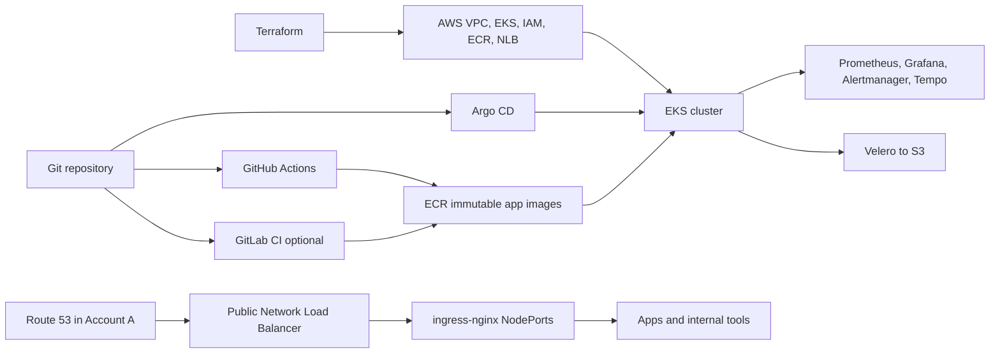

# Architecture and component reference

## Purpose and boundaries

This repository provisions a small AWS EKS platform in Frankfurt
(`eu-central-1`) and deploys three demonstration applications. Terraform owns
AWS infrastructure and IAM. Argo CD owns Kubernetes add-ons, policies,
observability, backup configuration, and app releases from the `develop`
branch. GitHub Actions currently tests and publishes app images. GitLab CI
support is optional and described in [GitLab CI setup](../.gitlab/README.md).

Dev and QA are separate VPCs, EKS clusters, ECR repositories, Terraform state
keys, and Argo CD roots in AWS Account B. The shared S3 bucket is
`tf-gitops-nikhil`; Terraform uses `dev/terraform.tfstate` and
`qa/terraform.tfstate`, while Velero uses separate `backup/dev` and
`backup/qa` prefixes. The domain and authoritative Route 53 zone are in Account
A. DNS is managed outside these Terraform roots.

## AWS foundation managed by Terraform

| Component | What it does | Current design |
| --- | --- | --- |
| VPC | Isolates cluster networking | Three public and three private subnets across three Frankfurt AZs; one NAT Gateway per environment to control cost. |
| EKS | Managed Kubernetes control plane | Kubernetes 1.33; public and private API endpoint, with public access restricted to configured trusted CIDRs; API, audit, authenticator, controller-manager, and scheduler logs enabled. |
| Core node group | Baseline capacity for controllers and system pods | EC2 On-Demand managed node group in private subnets; dev currently uses two `t3.large` nodes. Terraform ignores desired-size drift so manual scaling can support pause/resume. |
| EKS add-ons | Node networking, DNS, service routing, identity, persistent volumes | `vpc-cni`, `coredns`, `kube-proxy`, `eks-pod-identity-agent`, and `aws-ebs-csi-driver` are installed by EKS/Terraform before nodes. Dev and QA pin versions in their Terraform variable files; see version policy below. |
| ECR | Stores app images | Separate dev/QA repositories; immutable tags, scan-on-push, AES-256 encryption, lifecycle retention of the newest 30 images. |
| IAM for workloads | Gives selected pods scoped AWS access | EKS Pod Identity associations for EBS CSI, AWS Load Balancer Controller, Karpenter, External Secrets, and Velero. No AWS keys are stored in Kubernetes manifests. |
| Ingress NLB | Stable public TCP entry point | Terraform-managed NLB listens on 80/443 and forwards to worker NodePorts 30080/30443. DNS records are managed in Account A. |
| Velero IAM and S3 | Lets Velero write to its environment prefix | Role permissions scope object access to `backup/dev` or `backup/qa`; bucket is shared with Terraform state and is not created here. |
| Karpenter IAM/event path | Provisions and reclaims worker capacity | Controller role scoped to this cluster's resources; EventBridge sends interruption events to an encrypted SQS queue. |

### EKS add-on version policy

Exact version pins are not required for EKS to install add-ons. They are a
repeatability control: ordinary Terraform plans do not silently select each
new AWS build. Dev's version map is scoped to Kubernetes 1.33 and should be
reviewed during planned cluster/add-on upgrades. The reusable EKS module uses
latest-compatible selection only when `addon_versions` is not supplied. Do
not treat a mutable “latest” lookup as a stable pin: check AWS compatibility
and review the plan before updating pins. Dev and QA use the same explicit map
so routine plans in either environment remain stable.

Current pinned builds:

| EKS add-on | Version |
| --- | --- |
| VPC CNI | `v1.23.2-eksbuild.6` |
| CoreDNS | `v1.13.2-eksbuild.59` |
| kube-proxy | `v1.33.10-eksbuild.59` |
| EKS Pod Identity Agent | `v1.4.1-eksbuild.2` |
| AWS EBS CSI Driver | `v1.67.1-eksbuild.1` |

### Network and request flow

Public DNS names point to the Terraform-created NLB. The NLB forwards TCP to
NodePorts on worker nodes. `ingress-nginx` routes HTTP by host/path and
terminates TLS. `cert-manager` uses Let's Encrypt HTTP-01 challenges, so public
DNS and port 80 must work during first issuance and renewal. The NLB does not
terminate TLS and wildcard DNS does not create a wildcard certificate.

Argo CD, Grafana, Prometheus, and Alertmanager Ingresses use source-IP
allowlists. The demo application is public. Tempo and the OpenTelemetry
collector are cluster-internal. Update allowlists when trusted egress IPs
change; never replace them with `0.0.0.0/0`.

## Cluster capacity: managed nodes and Karpenter

The core EKS managed node group is the On-Demand baseline. It is intended to
run essential controllers and system services and has Terraform-configured
minimum, maximum, and desired capacity (dev currently 2/2/2). For an overnight
pause, reduce GitOps workload replicas and Karpenter limits first, then reduce
managed node group desired size using the runbook. Changing only the managed
group does not stop Karpenter.

Karpenter is a separate autoscaler that can create EC2 nodes for pending pods:

| NodePool | Capacity type | Scheduling intent |
| --- | --- | --- |
| `spot` | EC2 Spot | Higher weight (`50`), so Karpenter prefers it when constraints and capacity permit. Useful for interruptible, replaceable workloads. |
| `on-demand` | EC2 On-Demand | Lower weight (`10`), used when Spot does not satisfy scheduling/capacity needs or pod constraints require it. |

Both pools allow Linux/amd64, instance categories `c`, `m`, and `r`,
generation greater than 2, and reference the shared `default` EC2NodeClass.
Each currently has a 20-vCPU limit, expires nodes after 720 hours, and
consolidates empty or underutilized nodes after one minute. The NodeClass
selects the latest Amazon Linux 2023 AMI alias and discovers tagged private
subnets/security groups. Spot is interruptible; production workloads need
explicit disruption budgets, workload tolerations/affinity, capacity
diversification, and tested interruption handling.

## GitOps and Kubernetes components

`platform/argocd/dev-root.yaml` creates the dev parent Application, which
discovers `platform/addons/dev/**/application.yaml` and
`platform/apps/dev/**/application.yaml`. QA uses the matching QA root and
folders. Argo CD tracks `develop` with automated sync, pruning, and self-heal.
App image tags and environment values are committed to Git; Argo CD does not
read Terraform outputs or build images.

This is the **app-of-apps pattern**: one parent Application finds the child
Application definitions, and Argo CD then manages each child app separately.
The Argo CD chart also installs the ApplicationSet controller, but this repo
does not currently define any `ApplicationSet` resources. For our current
number of environments and apps, explicit child files are easy to review. An
ApplicationSet becomes useful when we want to generate many similar
Applications, for example one copy of an add-on across several clusters.

| Component | Role in the platform |
| --- | --- |
| Argo CD | GitOps controller installed in each cluster using `helm/argocd/values.yaml`. All current child Applications use Argo CD's `default` AppProject; production should define restrictive Projects. Ingress is enabled only after ingress-nginx and its admission Service are ready, avoiding HTTP-01 bootstrap races. |
| AWS Load Balancer Controller | Manages AWS load balancer Kubernetes resources and validates AWS Ingress resources. This project uses Terraform's NLB and ingress-nginx NodePorts, so its service-mutator webhook is disabled. Its webhook must be healthy before ingress-nginx Services are admitted. |
| ingress-nginx | DaemonSet controller, NodePort Service, and admission webhook; receives NLB traffic and routes to app/tool Services. Desired pods target Linux nodes labeled `role=core`. |
| cert-manager | Creates and renews per-host TLS certificates from Let's Encrypt with the `letsencrypt-prod` ClusterIssuer. First issuance depends on working DNS, public HTTP, the `nginx` IngressClass, and admission Service. |
| Karpenter | Installs the controller and CRDs; separate NodePool/EC2NodeClass YAML lives under `platform/karpenter/<environment>/`. |
| External Secrets | Reads scoped Secrets Manager paths through Pod Identity and projects named keys into Kubernetes Secrets. The example requires the AWS secret to exist; a Ready ClusterSecretStore does not prove a particular secret exists. |
| Metrics Server | Supplies resource metrics for Kubernetes tooling and autoscaling APIs. |
| kube-prometheus-stack | Installs Prometheus Operator, Prometheus, Alertmanager, kube-state-metrics, node-exporter, Kubernetes-mixin alert/recording rules, and Grafana dashboards. Prometheus/Grafana/Alertmanager data is on encrypted gp3 PVCs. |
| OpenTelemetry Collector | Receives OTLP traces/metrics/logs on internal ClusterIP endpoints. Traces go to Tempo; collector metrics are scraped by Prometheus; logs use a debug exporter and are not persisted/searchable. |
| Tempo | Internal trace backend queried by Grafana; no external Ingress. |
| Velero | Daily backup schedule to the environment S3 prefix, currently includes only `default`. Node agent uses Kopia. EBS snapshots are disabled. The chart's pre-upgrade CRD hook is disabled because its helper container setup failed in this cluster; CRD upgrades need deliberate handling. |
| gp3 StorageClass | Non-default encrypted gp3 via EBS CSI, `WaitForFirstConsumer`, expansion enabled. PVCs survive pod restarts; current manifests do not provide a full backup/restore strategy for monitoring data. |
| Default namespace security | Applies Pod Security Admission `restricted` labels to `default` at Kubernetes 1.33. Other namespaces need separate review. |

## Helm charts, AWS modules, and tools

Argo CD reads each Helm chart revision from the corresponding Application
manifest. These are the versions currently written in the repository:

| Component | Chart/version in Git | Purpose |
| --- | --- | --- |
| Argo CD | `argo-cd` chart `10.10.5` (configured app version `v3.5.5`) | GitOps controller and web UI. |
| AWS Load Balancer Controller | `1.14.0` | AWS load-balancer integration and admission webhooks. |
| cert-manager | `1.17.2` | Kubernetes certificate requests and Let's Encrypt HTTP-01. |
| ingress-nginx | chart `4.12.1` (controller image `v1.12.1`) | HTTP routing and TLS termination behind the NLB. |
| Karpenter | `1.6.2` | Creates EC2 capacity for pending pods and NodePools. |
| External Secrets | `0.15.1` | Copies selected AWS Secrets Manager values into Kubernetes Secrets. |
| Metrics Server | `3.12.2` | Resource metrics API. |
| kube-prometheus-stack | `91.5.1` | Prometheus Operator, Prometheus, Grafana, Alertmanager, and Kubernetes dashboards/rules. |
| OpenTelemetry Collector | `0.113.0` | OTLP receiver and telemetry forwarding. |
| Tempo | `1.23.0` | Internal trace storage. |
| Velero | chart `8.6.0` (configured app image `v1.15.2`) | Kubernetes resource and filesystem backups. |

### What the main platform services do

- **Argo CD** watches the `develop` branch and keeps the cluster aligned with
  the `platform/` manifests. The dev root creates child Applications for
  add-ons and apps. Automatic prune and self-heal are enabled. All current
  Applications use the built-in `default` Argo CD Project.
- **AWS Load Balancer Controller** has an IAM role through EKS Pod Identity.
  Its webhook is needed when Kubernetes admits some AWS networking resources.
  The Service mutator is off because ingress uses a Terraform NLB and NodePort
  Service instead.
- **cert-manager** uses the `letsencrypt-prod` ClusterIssuer with HTTP-01. Each
  Ingress requests a certificate stored in a Kubernetes TLS Secret. DNS, port
  80, the nginx IngressClass, and the ingress admission Service must all work.
- **Prometheus and Alertmanager** use gp3 PVCs of 20 GiB and 5 GiB. Prometheus
  keeps 7 days of data and receives Kubernetes-mixin rules. An empty firing
  alert list can be normal when no rule is currently firing.
- **Grafana** has a 5 GiB gp3 PVC, a dashboard sidecar that discovers
  Kubernetes-mixin dashboard ConfigMaps, Prometheus as the metrics source, and
  Tempo as a trace source. Its public Ingress is source-IP restricted.
- **OpenTelemetry Collector** receives OTLP gRPC on 4317 and HTTP on 4318.
  It sends traces to Tempo, exposes its own Prometheus metrics on 8889, and
  currently writes logs to a debug exporter; it is not a log database.
- **Velero** runs a daily schedule (`0 2 * * *`) with 7-day backup retention.
  It currently includes only namespace `default`, uses Kopia for file backup,
  and has EBS snapshots disabled. The chart's failing CRD-upgrade hook is
  disabled, so review CRD changes deliberately during chart upgrades.
- **ingress-nginx** runs as a DaemonSet on core Linux nodes. Its NodePort
  Service exposes 30080/30443 for the NLB target groups; it routes by hostname
  and terminates the Let's Encrypt certificates.

Terraform uses the upstream `terraform-aws-modules/eks/aws` module at `~> 21.0`
and `terraform-aws-modules/vpc/aws` at `~> 6.0`. ECR, Karpenter IAM, platform
AWS IAM, and NLB are local modules under `terraform/modules/`. AWS and Helm
providers are constrained to `~> 6.0` and `~> 3.0`; Terraform itself requires
`>= 1.14.0`.

The main local scripts are:

- `apps/image.sh`: builds and pushes the three demo images to an environment's
  ECR repositories, then edits that environment's Helm values. Review and
  commit those edits to deploy them through Argo CD.
- `scripts/port-forward.sh`: starts, checks, or stops local-only forwards to
  app and platform services.
- `scripts/mirror-addon-charts.sh`: helper for mirroring add-on charts; inspect
  its options before using it.
- `.gitlab/ci/publish-image.sh`: GitLab's OIDC ECR publish and GitOps merge
  request helper.

Other operator tools are AWS CLI (AWS accounts, EKS, ECR, and Terraform
authentication), Terraform (AWS infrastructure), `kubectl` (cluster
inspection), Helm (Argo CD installation and chart checks), Git, and Docker
(building app images). CI uses Gitleaks for secret detection, Python's
`unittest` and `pip-audit`, Maven for Java checks, and Trivy for image
vulnerability scanning. GitHub runs Trivy through `aquasecurity/trivy-action`
`v0.36.0`; the GitLab job installs Trivy in its Alpine job image.

### OIDC and AWS permissions

GitHub Actions gets an ID token and assumes an IAM role through the
`token.actions.githubusercontent.com` OIDC provider. Trust is restricted to
the configured repository's `develop` branch. GitLab can use the same
per-environment ECR push role through the `https://gitlab.com` OIDC provider;
its provider and trust statement are optional and disabled by default. When
enabled, trust matches the configured GitLab project path and `develop`
branch. Both CI roles can push only to that environment's three ECR app
repositories. Neither pipeline needs AWS access keys.

### Certificates

The `letsencrypt-prod` ClusterIssuer uses Let's Encrypt's production ACME
endpoint and HTTP-01 challenges through ingress-nginx. Certificates are
per-host Ingress TLS secrets, not one wildcard certificate. For issuance and
renewal, DNS must point to the NLB and public HTTP port 80 must reach the
controller. The first Argo CD certificate also depends on the ingress class
and admission Service being ready before Argo CD's Ingress is enabled.

## Public domains and URLs

These are the dev hosts configured in Git. The four admin pages have
source-IP allowlists; `dev.appledore.in` is public. The sample host serves the
NGINX demo.

| Host | Routes to | TLS secret |
| --- | --- | --- |
| `dev.appledore.in` | NGINX demo app | `nginx-demo-dev-appledore-tls` |
| `appledore.in` | NGINX demo app (host rule prepared in the current working changes) | `nginx-demo-dev-appledore-tls` |
| `www.appledore.in` | NGINX demo app (host rule prepared in the current working changes) | `nginx-demo-dev-appledore-tls` |
| `argocd.dev.appledore.in` | Argo CD | `argocd-dev-appledore-tls` |
| `grafana.dev.appledore.in` | Grafana | `grafana-dev-appledore-tls` |
| `prometheus.dev.appledore.in` | Prometheus | `prometheus-dev-appledore-tls` |
| `alertmanager.dev.appledore.in` | Alertmanager | `alertmanager-dev-appledore-tls` |

Tempo, the OpenTelemetry receiver, Velero, and Java/Python demo services do
not have public hostnames. Use the local port-forward script for services it
supports.

The `www.appledore.in` CNAME and the root-domain A Alias point to the NLB in
Account A. The working changes in this repository add both names as
Ingress/TLS hosts for the NGINX demo app. DNS can reach the NLB before those
Git changes are deployed; until the live Ingress has matching host rules,
NGINX returns its default 404 page. After pushing and syncing the changes,
check that cert-manager has issued the TLS secret for both names.

### Sample applications

- `python-demo`: Python service with a persistent volume claim.
- `java-demo`: Java service.
- `nginx-demo`: NGINX service with an Ingress used to validate public routing.

Each app has a Helm chart in `helm/apps/<app>/`; Argo CD references those
charts as Git sources, with image, replica, resource, and Ingress settings in
environment-specific values files. Platform add-on chart sources and
revisions are declared in `platform/addons/<environment>/*/application.yaml`.
Each app has environment values in `values-dev.yaml` and `values-qa.yaml`, and an Argo CD Application in
`platform/apps/<environment>/`. Publishing creates an immutable image tag;
promotion changes environment values in Git and Argo CD deploys the change.

## CI pipelines and release ownership

GitHub Actions is configured in `.github/workflows/ci.yml`. It scans repository
secrets, lints/renders app charts, runs Python and Java tests, builds app
images, scans for critical unfixed vulnerabilities, and offers a manual image
promotion flow for dev or QA. AWS credentials use GitHub OIDC.

The new `.gitlab-ci.yml` includes jobs from `.gitlab/ci/`. It provides secret
scanning, Helm checks, app tests, image build/security scan, and a manual
publish/promotion job. GitLab AWS trust is disabled by default in Terraform;
enable it only after setting up the GitLab project and reviewing the IAM plan.
Both systems share the per-environment ECR push role, restricted to the
configured repository's `develop` branch.

Terraform owns cloud resources and EKS-managed add-ons; Argo CD owns
Kubernetes add-ons and workloads. Avoid parallel manual Helm installs for
Argo-managed Applications.

## Security and reliability assessment

### Controls already present

- Public EKS API access is restricted to configured CIDRs; private API access
  is enabled.
- EKS control-plane audit and API logs are enabled.
- CI uses federated OIDC instead of static AWS access keys. ECR push actions
  are limited to app repositories and the `develop` ref.
- App images use immutable tags, encryption at rest, scan-on-push, lifecycle
  retention, and CI vulnerability scanning.
- Workload AWS access is separated into Pod Identity roles; sample IAM access
  is scoped by service and resource prefix.
- Admin UI Ingresses use source CIDR allowlists; TLS certificates are
  automated.
- EBS gp3 volumes are encrypted; Karpenter's interruption queue uses SQS
  managed encryption and rejects insecure transport.
- The `default` namespace has restricted Pod Security Admission labels.

### Production gaps to close

This is a single-cluster demo/QA setup, not a production-ready service. Before
production, review and implement:

1. **Identity and access:** configure SSO/MFA for Argo CD and Grafana; use
   least-privilege RBAC and separate human/admin roles; consider private API
   access through VPN rather than a public endpoint allowlist.
2. **Availability:** use multi-AZ NAT or VPC endpoints; maintain enough
   On-Demand baseline capacity across AZs; test AZ/node loss; add workload
   replicas, PDBs, probes, topology spread, and capacity-aware scheduling.
3. **Secrets and state:** avoid sharing a bucket for Terraform state and
   backups; enable versioning, restrictive bucket policies, public-access
   blocking, encryption, and separate retention. Confirm real secrets are
   created, rotated, and scoped.
4. **Backups and recovery:** back up every stateful namespace/data set; define
   RPO/RTO; test restore into a clean cluster; configure EBS snapshots if
   needed. Velero currently covers only `default` and snapshots are off.
5. **Observability:** configure durable alert routing/receivers, log storage,
   and external monitoring for control plane/backups. OTEL logs are debug-only
   and Prometheus retention is 7 days.
6. **Supply chain:** pin CI actions, base images, and dependencies to reviewed
   versions/digests; produce SBOMs and signatures; set promotion approvals and
   vulnerability SLAs.
7. **Governance:** replace Argo CD's default project with restricted Projects;
   enforce policies across namespaces, resource quotas/limits, network
   policies, admission controls, and protected Git branches/environments.
8. **Operations/DR:** document and test incident, upgrade, and restore
   runbooks; define maintenance windows and rollback paths; separate
   dev/QA/production AWS accounts and state/backups.

These controls must be matched to workload requirements. Adding replicas alone
does not establish production availability.
